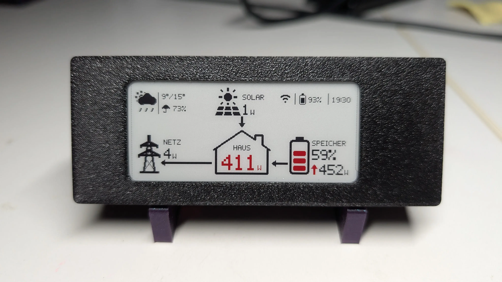
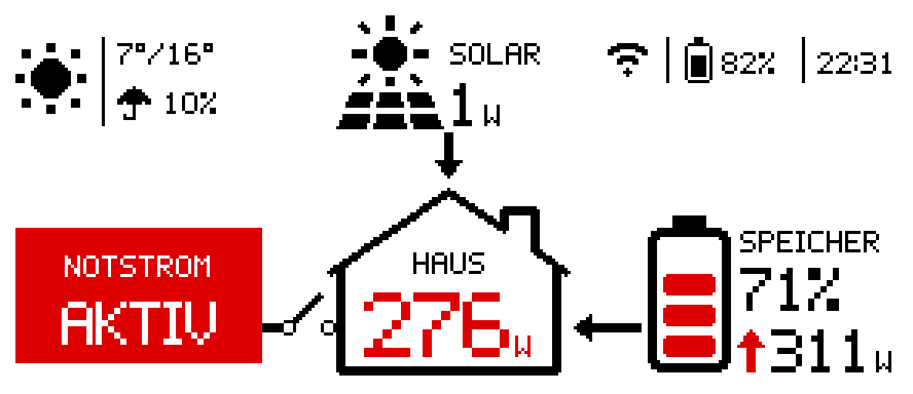
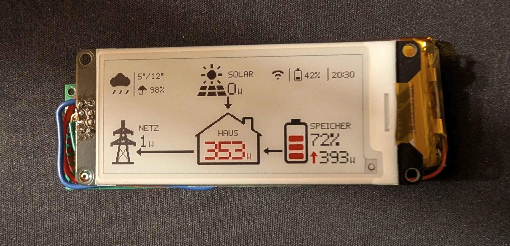
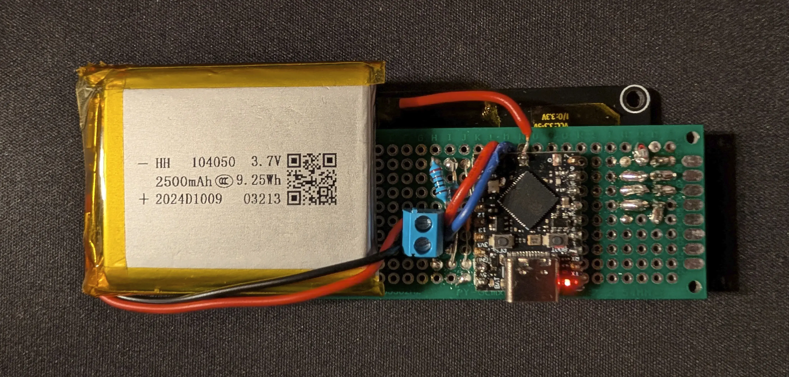
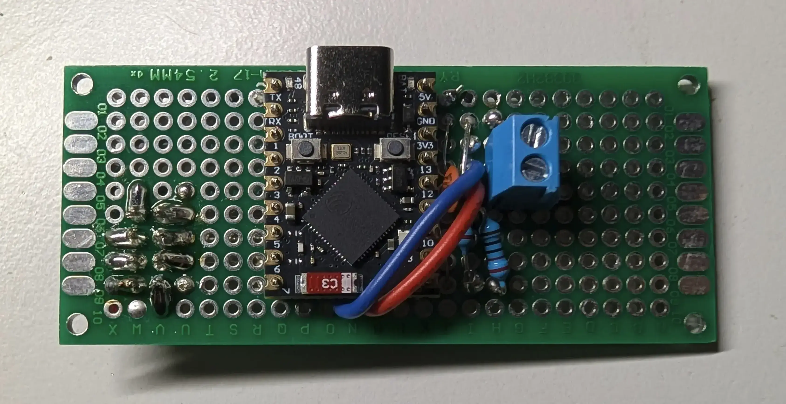
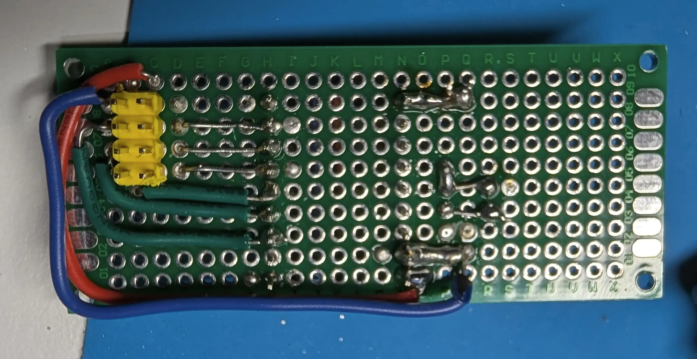
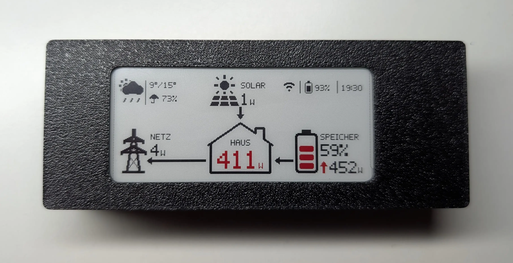
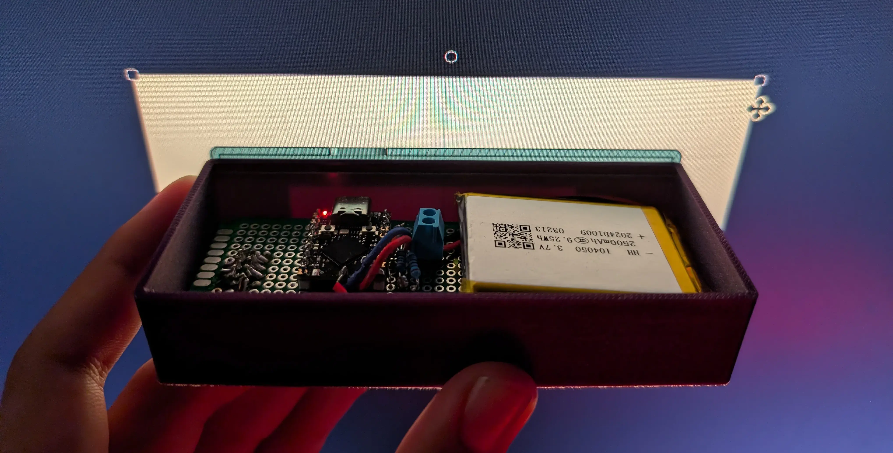
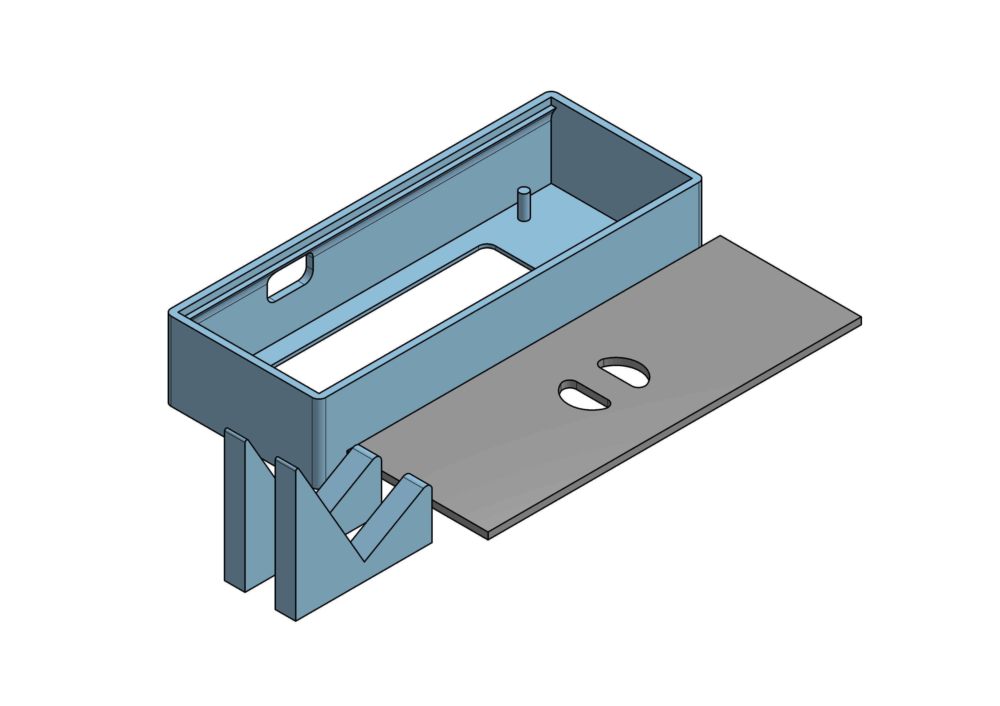

# SolarEInk: Solar data on e-paper


Show your current solar production, house consumption and battery stats on a neat little 2.9-inch e-ink display, powered by an ESP32 S3 Supermini. Uses the JSON SolarAPI of the Fronius Symo GEN24 Plus and OpenMeteo to determine which data to show. The screen updates every 15 minutes, skips during nightly hours and deep sleeps when idle. Optional telemetry can be stored in InfluxDB.

> [!IMPORTANT]
> Currently only the Fronius Symo GEN24 Plus inverter is tested and supported. It should however be quite easy to extend the current fetching system to other platforms. Feel free to open up a pull request if you do!

## What it shows
<p align="center">
  
</p>

- Solar production
- Home consumption
- Grid consumption or feed-in (arrow changes direction accordingly)
- In case of backup power: grid disconnect
- Battery discharge or charge (arrow changes direction accordingly)
- Battery state of charge
- Current weather (icon, min/max temperature and chance of rain)
- Whether the WiFi connection was successful
- Device's own battery percentage
- Time (shows the intended update time, even when it finishes a little early or a little late)
- Everything in German, feel free to add other languages :)

## Hardware
<p align="center">
    
    
</p>

- ESP32 S3 Supermini
- WeAct Studio e-paper module: 2.9-inch, 296 x 128, black/white/red
- Two 220 kΩ resistors and one 100 nF capacitor for the voltage divider
- A 1S lithium battery (suitable for the built-in charge IC)
- Two slot screw terminal
- A perfboard to solder everything on to
- A few cables (ideally different colors)

## Wiring
<p align="center">
    
    
</p>

These connections match the default pin assignments in `include/app_config.h`.

| WeAct display pin | ESP32-S3 SuperMini connection | Function |
| - | - | - |
| VCC | 5 V supply | Display module power; module supports 3.3-5 V |
| GND | GND | Common ground |
| SDA / DIN | GPIO6 | SPI MOSI |
| SCL / CLK | GPIO1 | SPI clock |
| CS | GPIO5 | SPI chip select |
| D/C | GPIO2 | Data/command selection |
| RES / RST | GPIO4 | Display reset |
| BUSY | GPIO3 | Display busy signal |

The display's SDA and SCL labels refer to SPI MOSI and SCK, not I2C. Signal levels come directly from the ESP32’s 3.3 V GPIOs.

Disconnect power before wiring. The ESP32 and display must share a common ground. A battery connection does not automatically provide regulated 5 V; the display supply must match your power arrangement.

### Optional device battery measurement

The firmware measures the device lithium battery through a resistor divider:

```text
LiPo positive ── 220 kΩ ──┬── GPIO8
                          ├── 220 kΩ ── GND
                          └── 100 nF ── GND
```

The lower 220 kΩ resistor and 100 nF capacitor are in parallel, each connected from GPIO8 to GND. Do not connect LiPo positive directly to GPIO8. The divider halves the battery voltage before it reaches the ADC.

## 3D printed case
<table>
  <tr>
    <td>
      <br>
      
    </td>
    <td valign="middle">
      
    </td>
  </tr>
</table>

The case consists of the shell with cylinders that match the positions of the holes in the e-ink display for alignment and a lid that press-fits into place.

In addition to the case, two feet can be printed to present the display at a comfortable angle when the device is positioned on a desk. 

All STEP and STL files can be found in the `cad` directory.

> [!WARNING]
> It is very likely that your dimensions will be slightly different and thus blindly trusting and printing the provided objects would be a bad idea. Confirm or adjust the models before committing to a print.

## Daily behavior

The display updates every 15 minutes from 06:00 through 23:00 local time, inclusive. That is 69 scheduled display refreshes per day. Overnight, the device sleeps through the display update window.

At 05:00, it wakes for a time-sync checkup. It connects to Wi-Fi and synchronizes the clock when possible, but does not fetch solar or weather data and does not refresh the display. It then sleeps until about 05:59 to prepare for the 06:00 update.

The timezone defaults to Central European time and handles CET/CEST daylight saving changes. If the clock has not synchronized, the display shows `--:--` and scheduling uses relative timing until NTP succeeds.

A full three-color refresh takes about 27 seconds and visibly flashes. The image remains on the panel while the ESP32 deep-sleeps. USB serial disconnecting during deep sleep is expected.

## What happens in one cycle

A normal update cycle proceeds as follows:

1. **Wake and identify the cycle:** The firmware records the wake cause, reset reason, and RTC-retained boot count.
2. **Measure the device battery:** Before starting Wi-Fi or the display, it takes 32 calibrated millivolt samples from GPIO8, trims the four highest and lowest, and calculates battery voltage using the divider factor of two.
3. **Connect to Wi-Fi:** It first tries the access point cached from the previous successful connection, then falls back to a normal scan and retry sequence if needed.
4. **Synchronize time when due:** NTP runs on the first successful connection and every six hours thereafter.
5. **Fetch solar and weather data:** The firmware requests the local Fronius Solar API and Open-Meteo forecast. Each API request can make up to ten attempts, with a 250 ms pause between failed attempts. Failure of one source does not prevent trying the other.
6. **Send the pending telemetry record, if enabled:** The record from the previous completed cycle is posted during this cycle’s Wi-Fi window. A failed post is recorded for the next point; a cold boot has no previous cycle to post.
7. **Prepare and update the display:** The dashboard shows the latest valid readings. Missing or invalid readings appear as `--`.
8. **Turn off Wi-Fi and sleep:** The panel is hibernated before the ESP32 enters deep sleep. The next wake is scheduled for the next aligned update, allowing time for preparation and refresh.

A cycle that finishes up to two minutes after its intended boundary can still show that boundary’s time. If it finishes later, the missed update is skipped.

## Setup

### 1. Prepare the hardware

You need:

- An ESP32-S3 Supermini compatible with this project's 4 MB flash configuration
- A WeAct 296 x 128 black/white/red e-paper module using the GDEM029C90 / SSD1680 panel
- A USB data cable
- Wiring and a suitable power supply
- Optionally, the battery measurement components listed above

Wire the display using the table above. Other 2.9-inch panels may require a different display driver, even if their resolution matches.

For initial setup, use USB power and keep the board accessible so you can press BOOT and RST.

### 2. Install PlatformIO

Install Visual Studio Code and the **PlatformIO IDE** extension, then open the project folder.

Alternatively, use an existing PlatformIO Core installation.

The commands below assume `pio` is available in your terminal. With the VS Code extension, open a PlatformIO terminal.

PlatformIO installs the configured ESP32 platform and libraries during the first build.

### 3. Create your configuration

Copy the example configuration:

```sh
cp include/config.example.h include/solar_config.h
```

On Windows, you can copy and rename the file through your file manager instead.

Edit `include/solar_config.h` and set:

```cpp
constexpr char WIFI_SSID[] = "YOUR_WIFI_SSID";
constexpr char WIFI_PASSWORD[] = "YOUR_WIFI_PASSWORD";

constexpr char FRONIUS_IP[] = "192.168.1.100";

constexpr double WEATHER_LATITUDE = 52.5200;
constexpr double WEATHER_LONGITUDE = 13.4050;
```

Use a 2.4 GHz Wi-Fi network that can reach the inverter.

`FRONIUS_IP` must contain only the inverter's IP address, without `http://` or a URL path. A DHCP reservation in your router helps keep this address stable.

Enter your location as decimal latitude and longitude. Open-Meteo does not require an API key.

`solar_config.h` is ignored by Git. Keep passwords and telemetry tokens in this file.

### 4. Check inverter access

From a computer on the same network, open:

```text
http://<FRONIUS_IP>/solar_api/v1/GetPowerFlowRealtimeData.fcgi
```

Replace `<FRONIUS_IP>` with the inverter's address. The endpoint should return JSON containing `Body.Data.Site` and inverter data.

The firmware uses these power-flow signs:

| Field | Interpretation |
| --- | --- |
| `P_PV` | Positive = solar production |
| `P_Load` | Negative = house consumption; displayed as an absolute value |
| `P_Grid` | Positive = import; negative = export |
| `P_Akku` | Positive = battery discharge; negative = charge |
| Inverter `SOC` | House battery state of charge |
| `BackupMode` | Backup operation indicator |

These conventions match the installation this project was developed for. Verify them against your own installation.

### 5. Configure the update schedule

The defaults in `solar_config.h` are:

```cpp
constexpr uint32_t REFRESH_SECONDS = 900;
constexpr int FIRST_UPDATE_HOUR = 6;
constexpr int LAST_UPDATE_HOUR = 23;
constexpr int CHECKUP_HOUR = 5;
constexpr int MORNING_WAKE_BEFORE_MINUTES = 1;
```

This gives:

- A display update every 15 minutes, from 06:00 through 23:00
- A Wi-Fi/time-sync-only checkup at 05:00
- A wake around 05:59 to prepare the 06:00 update

`REFRESH_SECONDS` is the target update interval, not the raw deep-sleep duration. It must be a positive multiple of 60; keep 900 for quarter-hour updates.

The timezone is configured separately in `include/app_config.h`:

```cpp
constexpr char TIMEZONE[] = "CET-1CEST,M3.5.0,M10.5.0/3";
```

This provides Central European time with automatic summer/winter time changes. Change it if you use the device in another timezone.

### 6. Disable or configure telemetry

The example configuration contains a placeholder InfluxDB server address. If you do not use telemetry, explicitly set:

```cpp
constexpr char INFLUX_URL[] = "";
```

To enable InfluxDB v2 telemetry, configure:

```cpp
constexpr char DEVICE_NAME[] = "solareink";
constexpr char INFLUX_URL[] = "http://192.168.1.50:8086";
constexpr char INFLUX_ORG[] = "home";
constexpr char INFLUX_BUCKET[] = "solareink";
constexpr char INFLUX_TOKEN[] = "YOUR_INFLUX_TOKEN";
```

Use an existing organization and bucket, and a token with write access to that bucket.

Each completed cycle is staged in RTC memory and uploaded during the following cycle's Wi-Fi connection. The first cycle after flashing or a hardware reset has no previous record to upload.

### 7. Build the firmware

From the project directory:

```sh
pio run
```

The first build may take several minutes while PlatformIO downloads dependencies.

The build should finish with `SUCCESS`.

### 8. Flash the board

Close any serial monitor, connect the board with a USB data cable, then run:

```sh
pio run --target upload
```

If automatic connection fails:

1. Hold **BOOT**
2. Press and release **RST**
3. Release **BOOT**
4. Run the upload command again

If the board remains in download mode after uploading, press **RST** with BOOT released.

### 9. Follow the serial output

On Linux or macOS, run:

```sh
./monitor
```

The monitor uses PlatformIO's Python environment and follows the board when USB disconnects during deep sleep and reconnects on wake.

Close other serial monitors first. Press Ctrl+C to exit.

### 10. Verify the first update

Check the serial output for:

- Successful Wi-Fi connection
- Successful time synchronization
- Fronius and weather request results
- The planned update time and sleep duration

A cold boot first synchronizes time and schedules an aligned update. The panel may therefore wait until the next quarter-hour rather than refreshing immediately. Outside the daily update window, it waits for the morning schedule.

A full three-color refresh takes approximately 27 seconds. Visible flashing during the refresh is expected.

Afterward, the panel retains its image while the ESP32 sleeps. USB disconnecting during deep sleep is also expected.

### 11. Check orientation and battery voltage

If the display is upside down, change this in `include/app_config.h`:

```cpp
constexpr int DISPLAY_ROTATION = 3;
```

The default is `1`.

If using the battery divider, compare the reported voltage with a multimeter. Adjust `Hardware::BATTERY_CALIBRATION` if needed:

```text
new calibration = old calibration × measured voltage / reported voltage
```

The small device battery percentage is an estimate based on LiPo voltage. It is separate from the Fronius house battery SOC.

Rebuild and upload after configuration changes. Increment `App::FIRMWARE_VERSION` in `include/app_config.h` for each changed firmware you flash.

## Development

### Build and flash

```sh
pio run
pio run --target upload
```

For serial output, close other monitors and run:

```sh
./monitor
```

The board’s native USB serial port disconnects during deep sleep and may reappear on wake. The monitor script follows the board by USB serial number; press Ctrl+C to exit.

### Render dashboard previews

```sh
scripts/preview
```

The preview tool renders the dashboard code on the host without the ESP32. It requires a C++ compiler and Python Pillow. Generated PNGs go into the locally generated `previews/` directory.

### Regenerate fonts

After changing the source glyphs, regenerate the bundled font header:

```sh
python3 scripts/generate_fonts.py
```

### Main source files

| File | Purpose |
| --- | --- |
| `src/main.cpp` | Wake cycle, battery measurement, networking flow, scheduling, display update, and sleep |
| `src/network.cpp` | Wi-Fi connection and bounded HTTP requests |
| `src/metrics.cpp` | RTC-staged telemetry record and InfluxDB line protocol |
| `src/battery.cpp` | Device LiPo ADC measurement |
| `src/clock_sync.cpp` | NTP synchronization, timezone, and local-time scheduling |
| `src/dashboard.cpp` | Dashboard layout and drawing |
| `src/icons.cpp` | Dashboard icons and flow arrows |
| `include/logic.h` | Formatting, battery-voltage curve, weather groups, and schedule helpers |
| `include/app_config.h` | Hardware pins, timing constants, timezone, and firmware version |
| `include/config.example.h` | Example Wi-Fi, inverter, location, schedule, and telemetry configuration |

## InfluxDB fields

InfluxDB telemetry is optional. Set `INFLUX_URL` to an empty string to disable it. When enabled, the measurement is `solar`; each point has these three tags:

| Tag | Value |
| --- | --- |
| `name` | `DEVICE_NAME` |
| `mac` | Device Wi-Fi MAC address |
| `fw` | `App::FIRMWARE_VERSION` |

All remaining values are fields. Fields are omitted when they are unavailable or do not apply to that cycle.

| Group | Fields |
| --- | --- |
| Scheduler and boot | `boot_count`, `wake`, `reset`, `checkup`, `usb`, `plan`, `target`, `missed_ms`, `completion_err_ms`, `awake_ms` |
| Device battery | `device_v` (volts), `device_pct` |
| Wi-Fi | `wifi_ok`, `wifi_ms`, `wifi_cached`, `wifi_fallback`, `wifi_attempts`, `wifi_status`, `wifi_reason`, `rssi`, `channel`, `bssid`, `ip` |
| NTP and clock | `ntp_ran`, `ntp_ok`, `ntp_attempts`, `ntp_ms`, `ntp_drift_ms`, `sync_age_s`, `clock_ok` |
| Fronius | `fr_ok`, `fr_attempts`, `fr_ms`, `fr_http`, `fr_bytes`, `fr_pv_w`, `fr_load_w`, `fr_grid_w`, `fr_batt_w`, `fr_soc`, `fr_backup` |
| Open-Meteo | `wx_ok`, `wx_attempts`, `wx_ms`, `wx_http`, `wx_bytes`, `wx_tmin_c`, `wx_tmax_c`, `wx_precip_pct`, `wx_code` |
| Panel and light sleep | `prep_ms`, `refresh_ms`, `wait_sleeps`, `wait_slept_ms`, `ref_sleeps`, `ref_slept_ms`, `sleep_fails` |
| System | `chip_temp_c`, `heap_free`, `heap_min`, `heap_max` |
| Previous telemetry post | `prev_post_ok`, `prev_post_ms` |

Fronius and weather fields are recorded on normal Wi-Fi cycles, but not on the 05:00 checkup. Panel timing fields are recorded on display-refresh cycles. Wi-Fi details such as RSSI, BSSID, and IP are present only when Wi-Fi connects successfully.

The point timestamp is the recorded cycle’s wake time, normally from the device clock. The first cycle after flashing or a hardware reset has no preceding record to upload.

---

Released under the MIT License; see `LICENSE`.

**AI disclosure:** Large parts of the firmware were generated with AI tools and have not been independently reviewed line by line by me. I designed the hardware and CAD models.
